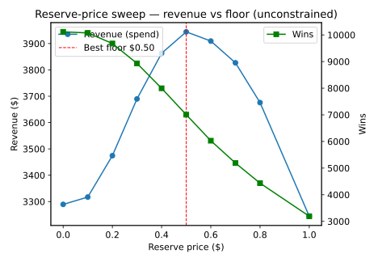
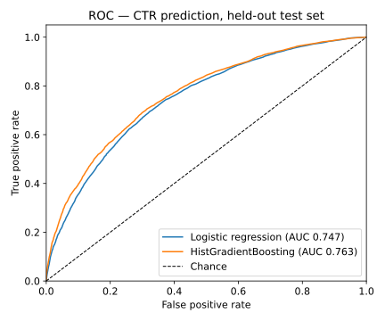
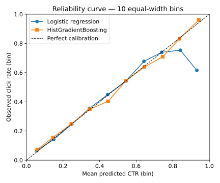
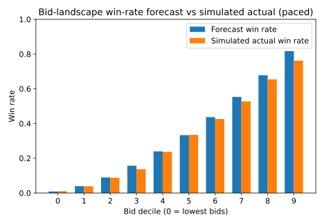
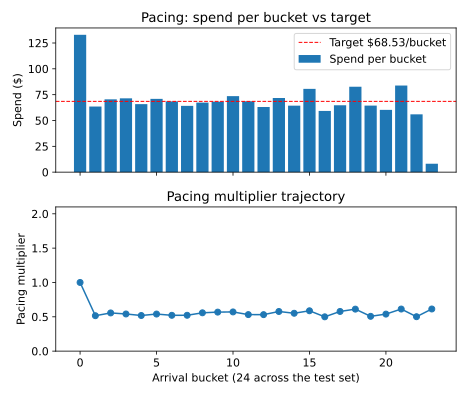

# Adtech CTR Prediction + Second-Price Auction

A personal project by Santhosh Chakilam (data scientist). CTR prediction
on the public Criteo display-ads sample, plus a second-price auction
simulator with pacing and bid-landscape win-rate forecasting.

## Data

The Criteo Display Advertising Challenge data (Kaggle 2014): each row is
one display-ad impression — a binary click label, 13 integer features
(I1..I13), and 26 hashed categorical features (C1..C26, 32-bit hex
strings, empty = missing). The full train set is 45.8M rows; this repo
uses the 100,000-row sample `dac_sample.tar.gz` from Microsoft
Recommenders (hosted on Hugging Face as `Recommenders/criteo`), downloaded
at build time by `python scripts/download_data.py` into `data/raw/`
(gitignored). Only a 3,000-row sample is committed (`data/criteo_sample_3000.tsv`).

## What is built

**CTR prediction** (`src/adtech_ctr_auction/models.py`): logistic
regression (median-imputed + standardised numerics; one-hot of the 50
most frequent levels per categorical column, rarer levels folded into
OTHER) and HistGradientBoosting (median-imputed numerics; ordinal-encoded
categoricals with native categorical support). Evaluated on a held-out
split with AUC, log loss, Brier score, expected calibration error, and a
10-bin reliability curve.

**Second-price auction simulator** (`src/adtech_ctr_auction/auction.py`):
value-based bidding (bid = pCTR × value per click), second-price payment
(winner pays the highest competing bid), a LogNormal bid-landscape model
whose win-rate forecast is `P(competing bid < our bid)`, and a pacing
controller that shades bids per arrival bucket to track a fixed budget.
Reports the forecast vs simulated win rate overall and per bid decile,
spend vs budget, wins, and average clearing price — with and without pacing.

## How to run

```bash
python3 -m venv .venv
.venv/bin/pip install -r requirements.txt
python scripts/download_data.py   # downloads the 100k-row Criteo sample (~9 MB)
.venv/bin/python -m pytest tests/ -q
.venv/bin/python run_eval.py      # trains + evaluates, writes results.json
.venv/bin/python make_visuals.py  # results/*.svg + results/report.html
.venv/bin/python verify_results.py  # re-runs the eval, checks results.json + README
```

## Results

Measured by `python run_eval.py` on a forward-in-time split
of the 100,000 rows of the Criteo sample — train
80,000 / test 20,000. Every number below comes from a run of the code;
see `results.json`, `verify_results.py`, and `results/report.html`.

- Logistic regression AUC 0.7467, log loss 0.4744, Brier 0.1538, ECE 0.0073
- GBM AUC 0.7625, log loss 0.4610, Brier 0.1485, ECE 0.0112
- train 80000 / test 20000 (forward in time); train CTR 0.2245, test CTR 0.2353

| Model | AUC | Log loss | Brier | ECE |
|---|---|---|---|---|
| Logistic regression | 0.7467 | 0.4744 | 0.1538 | 0.0073 |
| HistGradientBoosting | 0.7625 | 0.4610 | 0.1485 | 0.0112 |

Second-price auction (GBM pCTR, value per click $2.50, LogNormal bid
landscape with mu -0.897, sigma 0.894, median competing bid $0.408):

| Run | Spend | Budget | Wins (of 20,000) | Pred win rate | Actual win rate | Abs error | Decile MAE | Avg clearing price |
|---|---|---|---|---|---|---|---|---|
| Unconstrained | $3,289.26 | — | 10,116 | 0.509 | 0.506 | 0.0037 | 0.0081 | $0.325 |
| Paced | $1,644.34 | $1,644.63 | 6,428 | 0.335 | 0.321 | 0.0138 | 0.0144 | $0.256 |
| Brand-safe paced | $1,644.07 | $1,644.63 | 6,347 | 0.344 | 0.317 | 0.0263 | 0.0264 | $0.259 |
| Ad-load-capped paced | $1,644.31 | $1,644.63 | 6,400 | 0.344 | 0.320 | 0.0235 | 0.0239 | $0.257 |

The paced run spent 99.98% of its budget across the 24 arrival buckets.
The brand-safe run blocked 795 impressions (synthetic categories:
political, firearms, tobacco) and won 81 fewer auctions for $0.27 less
spend. The ad-load-capped run (max 292 wins per bucket, 35% of a
bucket's impressions) suppressed 237 would-be wins and won 28 fewer
auctions for $0.03 less spend — the pacing controller absorbs both
constraints almost entirely, which is itself the finding: under a fixed
budget, the binding constraint is the budget, not the cap or the filter.

### Reserve-price sweep (yield)

A floor on the clearing price, swept over the unconstrained auction:

| Floor | Revenue | Wins | Avg clearing price |
|---|---|---|---|
| $0.00 | $3,289.26 | 10,116 | $0.325 |
| $0.10 | $3,317.05 | 10,075 | $0.329 |
| $0.20 | $3,474.28 | 9,677 | $0.359 |
| $0.30 | $3,689.80 | 8,931 | $0.413 |
| $0.40 | $3,863.08 | 7,997 | $0.483 |
| $0.50 | $3,944.56 | 7,006 | $0.563 |
| $0.60 | $3,909.50 | 6,028 | $0.649 |
| $0.70 | $3,826.90 | 5,189 | $0.738 |
| $0.80 | $3,675.82 | 4,434 | $0.829 |
| $1.00 | $3,244.16 | 3,191 | $1.017 |

Revenue peaks at a $0.50 floor ($3,944.56, +19.9% vs no floor) and falls
past it — the textbook reserve-price trade-off: the floor lifts the
clearing price on every win but prices out marginal impressions, and
past $0.50 the lost wins cost more than the higher prices gain.



### Marketplace constraints — what Netflix's ad business adds

A real in-house ad marketplace does not just run an auction; it runs
one inside member-experience, brand-safety, and yield constraints.
Three of them are implemented here, modelled on how Netflix's ad tier
actually operates:

- **Ad-load cap (member experience).** Netflix's Basic With Ads runs
  about 4–5 minutes of ads per hour, and its ads president has said
  the company is "incredibly strategic about how we present ads"
  because member experience comes first
  ([Deadline, Nov 3 2022](https://deadline.com/2022/11/netflix-ads-launch-what-to-know-1235162223/);
  [TechCrunch, May 15 2024](https://techcrunch.com/2024/05/15/netflix-in-house-advertising-technology-platform/)).
  The simulator caps wins per arrival bucket at 35% of the bucket's
  impressions.
- **Brand safety.** At launch Netflix excluded political ads, guns,
  smoking, and products it deems illegitimate (Deadline, Nov 3 2022).
  The simulator blocks those categories — but the categories are
  SYNTHETIC (seeded RNG, plausible shares), because the Criteo sample
  has no advertiser-category column.
- **Yield via reserve price.** Netflix built its own ad server in 2024
  to take full control of its advertising (TechCrunch, May 15 2024),
  moving off Microsoft's stack; owning the marketplace is what makes
  pricing levers like a reserve floor possible. The sweep above is
  that lever, measured.

None of this claims to reproduce Netflix's systems. The constraints
are policy choices applied to a simulator, measured honestly under
the stated parametric landscape.









### Reading the result honestly

- The GBM beats logistic regression on AUC by 0.016 (0.7625 vs 0.7467),
  as expected: the hashed categoricals carry interactions a linear model
  cannot see, and the one-hot top-50 encoding throws away the long tail.
  The gap is the honest size of the win on this subsample, not a claim
  about full-scale Criteo data.
- Calibration: both models' reliability curves are reported with ECE,
  not just AUC — a CTR model that ranks well but miscalibrates bids
  wrong in a second-price auction. LR is slightly better calibrated
  here (ECE 0.0073 vs 0.0112) despite the lower AUC.
- Forward-in-time drift is visible in the split itself: test CTR
  (0.2353) is higher than train CTR (0.2245). The models still rank
  well on later traffic, but the drift is why a time split is reported
  instead of a random one.
- The auction forecast error is measured against Monte Carlo simulation
  under the stated LogNormal landscape model, NOT against real auction
  logs (see Honest limits). It shows the forecaster is self-consistent,
  not that it predicts production win rates. Pacing works as designed:
  the paced run spent 99.98% of its $1,644.63 budget while winning fewer,
  cheaper impressions (avg clearing price $0.256 vs $0.325 unconstrained).
- The forecast does NOT know about the marketplace constraints, and it
  shows: the brand-safe run's win-rate forecast error (0.0263) and the
  capped run's (0.0235) are both larger than the plain paced run's
  (0.0138), because the forecast predicts wins the filter and the cap
  then take away. A production forecaster would need the constraints
  as inputs; here the gap is reported, not hidden.

## Preprocessing (as in the raw file)

- Integer features: missing values filled with the training median.
  No clipping or winsorising.
- Categorical features: hashed hex strings, kept as-is. Missing (empty
  in the raw file) becomes the level `MISSING`. Logistic regression sees
  only the 50 most frequent levels per column; HistGradientBoosting sees
  ordinal codes for the 254 most frequent levels per column (its
  `max_bins`=255 cap), with rarer and unseen levels folded into OTHER.
- Split: stratified random 80/20 (seed 42). The file carries no
  timestamp, so no time-based split is possible.

## Honest limits

- **The bid landscape is a parametric model, not a measurement.** The
  Criteo sample has no bid, cost, or auction column. Competing bids are
  modelled as LogNormal, calibrated to the location/spread of our own
  value-based bids (competition factor 1.0). The win-rate forecast error
  measures the forecaster against simulation under that model; it does
  not validate against real auction logs, and the spend / clearing-price
  figures are simulated dollars, not real money.
- **Value per click ($2.50) is an assumed constant**, not measured from
  advertiser data. Real value varies by campaign, user, and conversion.
- **Forward-in-time split, not a random split.** Rows are
  chronologically ordered (per the sample readme), so train is the
  first 80k rows and test is the next 20k. No timestamp column exists,
  so the split is by row order only.
- **Subsample scale.** 80k train / 20k test rows from a 100k-row sample
  of a 45.8M-row train set. Numbers on the full Criteo data (or the
  1TB click logs) are NOT claimed; that is bigger-machine / GPU work.
- **Hashed categoricals carry no semantics.** Rare levels are folded
  away for both models (top-50 for the linear model, top-254 for the
  GBM); the GBM cannot generalise to unseen hashes.
- **Advertiser categories are synthetic.** The Criteo sample has no
  category column. Categories in the brand-safety run are assigned by
  a seeded RNG with plausible shares (beer, automotive, fast-casual,
  travel, consumer packaged goods; blocked: political, firearms,
  tobacco). The filter's mechanics are real; the labels are not
  measured, and the blocked share (4%) is a choice, not a finding.
- **Ad-load cap and reserve floors are policy choices**, not
  production measurements. The 35%-of-bucket cap and the $0.00–$1.00
  floor sweep are applied to the simulator; spend and clearing prices
  are simulated dollars under the parametric landscape.
- **Single split, no cross-validation.** One GBM fit on 80k rows is
  already minutes on CPU; the reported numbers are one seeded split.
- No real adtech job experience is claimed. This is a personal project.

## Project layout

```
adtech-ctr-auction/
├── README.md
├── requirements.txt
├── run_eval.py            # train + evaluate + auction, write results.json
├── verify_results.py      # re-run the eval, check results.json + README + visuals
├── make_visuals.py        # regenerate results/*.svg + results/report.html
├── results.json           # measured results (generated by run_eval.py)
├── results/               # roc_comparison.svg, reliability.svg,
│                          # win_rate_forecast.svg, pacing.svg,
│                          # reserve_sweep.svg, report.html
├── data/
│   ├── README.md
│   ├── criteo_sample_3000.tsv   # committed 3,000-row sample
│   └── raw/dac_sample.txt        # full 100k-row sample (downloaded, gitignored)
├── scripts/download_data.py     # fetch dac_sample.tar.gz, write the sample
├── src/adtech_ctr_auction/
│   ├── data.py            # download + load the Criteo sample
│   ├── features.py        # preprocessing for LR and GBM
│   ├── models.py          # logistic regression + HistGradientBoosting + metrics
│   ├── auction.py         # LogNormal bid landscape + second-price simulator + pacing
│   └── eval.py            # end-to-end evaluation
└── tests/                 # pytest tests (synthetic data; no download needed)
```
